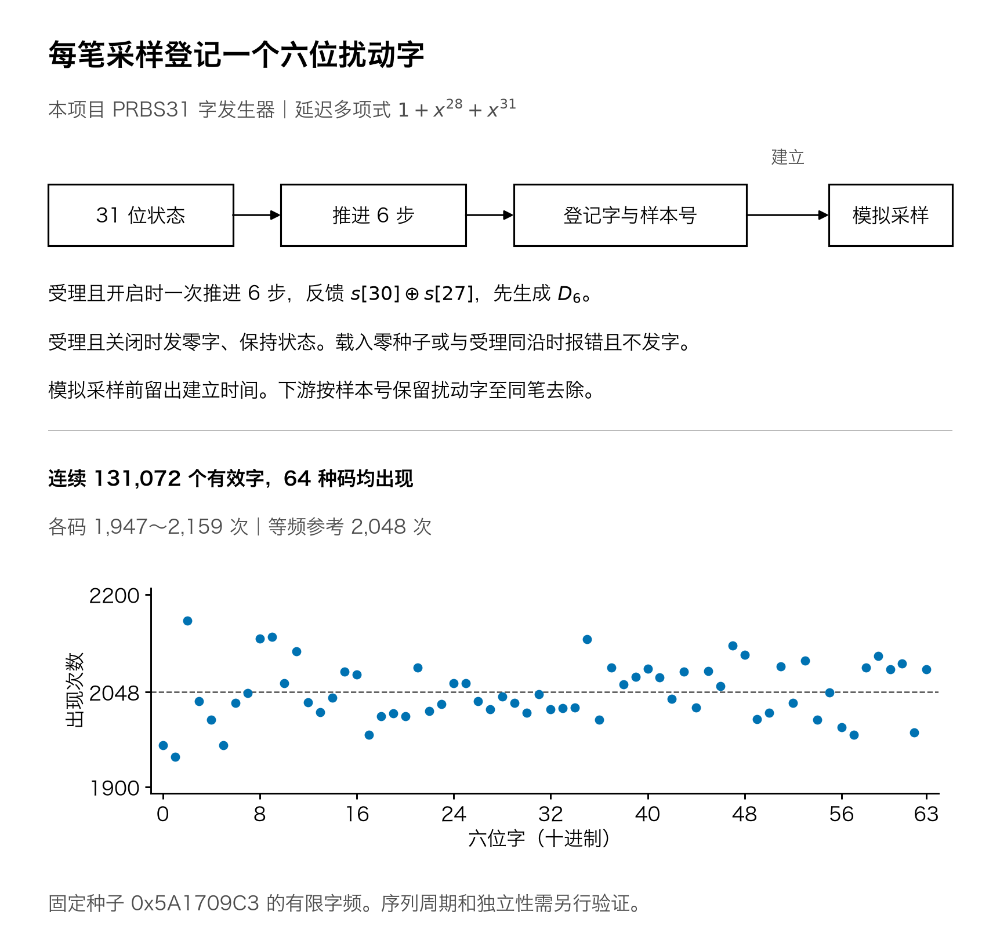
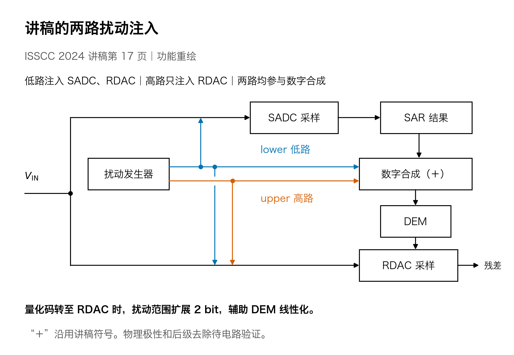
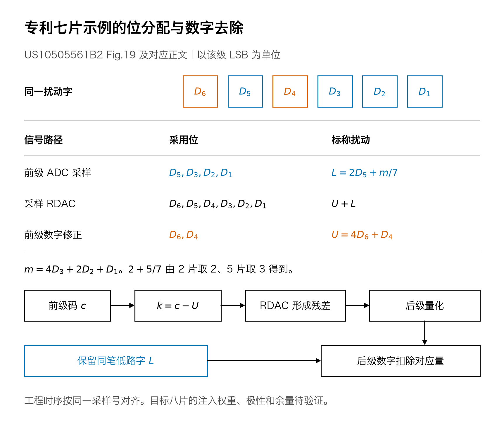
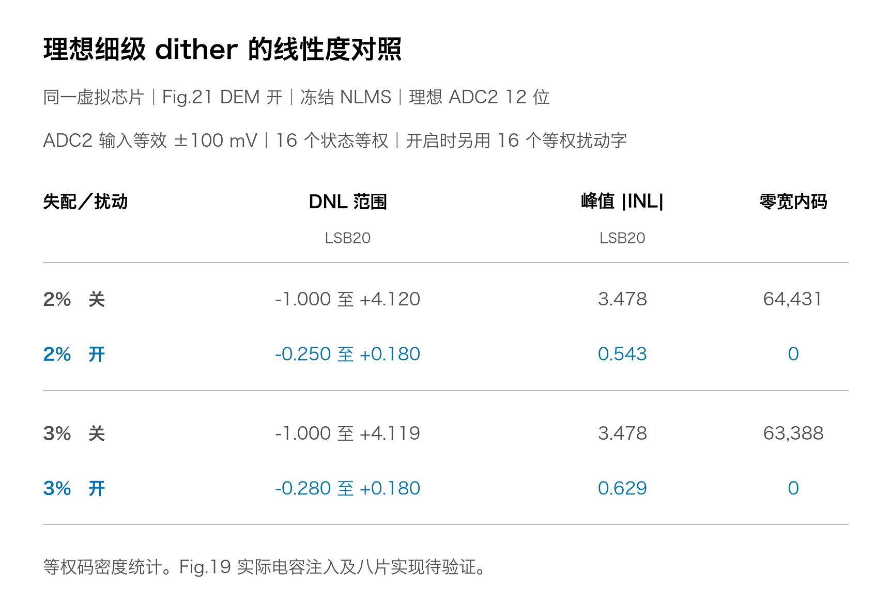

# 分路 dither 的路径和效果



本项目用 31 位状态生成六位字，在受理时登记该字与 32 位样本号，关闭时改为登记零字。模拟采样前留出建立时间。图中采用默认种子的连续 131,072 个字，逐拍与 Verilator 输出核对。 [RTL](../rtl/dither_word_gen.sv) · [对拍收据](../evidence/dither_rng/result.json)



低路进入 SADC 和 RDAC，高路只进入 RDAC。两路也进入 SAR 之后、DEM 之前的数字合成节点。图中保留讲稿的“＋”。论文称量化结果传到 RDAC 时，扰动范围扩展 2 bit，用来辅助 DAC 的 DEM 线性化。 [讲稿第 17 页](../../references/ISSCC2024_SLIDES.pdf#page=17) · [论文印刷页 182](https://doi.org/10.1109/ISSCC49657.2024.10454329)



专利正文在自身码域用 `k=c−U` 设定采样残差 DAC，并把低路字传给后级作数字去除。七片例的分数来自切片数比例。同一采样号的对齐属于本项目的工程时序要求。实际八片的注入权重、物理极性和前后级余量待验证。 [US10505561B2 Fig.19 和对应正文](https://patents.google.com/patent/US10505561B2/en#description)



这项模型实验在理想 ADC2 输入加入已知扰动，量化后扣除同笔对应量。两组共用固定失配、Fig.21 DEM 和冻结 NLMS。图中 DNL、端点 INL 和零宽内码数由归档的完整 20 位码宽复算。理想 ADC2 试验与 Fig.19 电容注入的验证分别记录。 [2% 逐码曲线](../../task1/evidence/adc2_dither/full20/adc2_12bit_sigma_2pct_dither.png) · [3% 逐码曲线](../../task1/evidence/adc2_dither/full20/adc2_12bit_sigma_3pct_dither.png) · [码宽归档与统计口径](../../task1/evidence/adc2_dither/full20/README.md)

从交付树根目录执行以下命令。需要 NumPy、Matplotlib，以及本机的 Hiragino Sans GB 或 Noto Sans CJK SC 字体。

```bash
python -m task2.tools.draw_dither
```

矢量版为 [PRBS31 发生器](dither_prbs31.svg)、[讲稿注入路径](dither_isscc_ppt.svg)、[专利七片示例](dither_fig19.svg) 和 [理想细级效果](dither_ideal_adc2_effect.svg)。[散列清单](manifest.json)记录输入原件、对拍收据、归档码宽、[绘图脚本](../tools/draw_dither.py)和输出图件。
