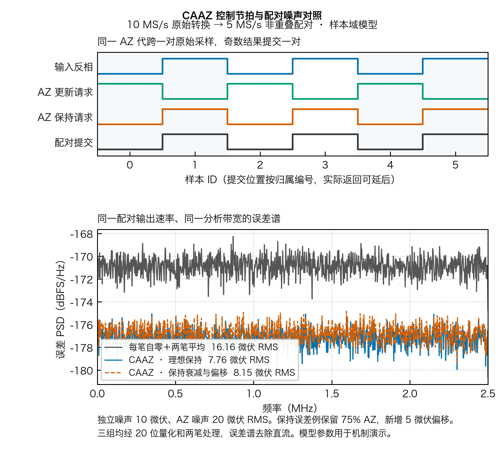

# 模块三 · CAAZ

CAAZ 对完整差分输入逐笔换相，偶数笔请求更新 CBIAS，奇数笔保持同一 AZ 代。ADC2、位权与同笔 dither 补偿完成后，数字端将偶数码减去奇数码并除以二。稳定工作时每两个 10 MS/s 原始结果提交一对，输出 5 MS/s。关闭 CAAZ 时逐笔旁路。



上图下半部分比较同为 5 MS/s、0～2.5 MHz 带宽的三组样本域结果。模型设置每笔独立噪声为 10 µV RMS，AZ 存储噪声为 20 µV RMS，输出均重新量化到 20 位。

| 处理方式 | 去直流误差（µV RMS） | 平均误差（µV） |
| :--- | ---: | ---: |
| 每笔自零，再两笔平均 | 16.16 | +42.41 |
| 偶数自零、奇数理想保持并反相 | 7.76 | +2.39 |
| 奇数保留 75% AZ 噪声，新增 5 µV 偏移 | 8.15 | −0.13 |

在此模型中，共用 AZ 样本比独立 AZ 后两笔平均的误差小 6.37 dB。若两相 AZ 传递增益分别为 `a_e`、`a_o`，奇数保持比例为 `h`，共同噪声项 `w` 的残余为 `(a_e−a_o·h)w/2`。这里的设置用于复核抵消机制，实际增益和保持误差由模拟验证给出。[数据、指标与图件哈希](evidence/behavior/caaz_effect_summary.json) · [原始轨迹](evidence/behavior/caaz_effect_data.npz) · [矢量图](evidence/behavior/caaz_effect.pdf)

| 源文位置 | 对应合同 | 当前边界 |
| :--- | :--- | :--- |
| Wang 等，VLSI 2025 Fig.5 | 在 ADC 输入换相，先做数据合并及位权校正，再作 `(1−z⁻¹)/2` | 本工程把运算限定在连续偶奇 pair，配对中点对应时间戳。两点平均幅频响应为 `abs(cos(πf/10 MHz))`，系统须另行定义抽二前带宽。 |
| 同论文 Fig.6，讲稿第 33～34 页 | 偶数笔采集 AZ 噪声，奇数笔不更新 CBIAS，沿用同一代；同相误差在偶减奇中抵消 | `acq_az_capture`／`hold` 给出带 ID 的请求。宏需执行实际开关、隔离和保持，并随结果确认。其普通复位和放大准备由模拟时序负责。 |
| 论文原型测量 | 论文将 4.3 dB 区分为 AZ 抵消的 1.3 dB 和普通平均的 3 dB | 本工程模型幅度和频率独立设定。10／5 MS/s 为项目规格。 |

[论文 Fig.5／6](../references/PKU_VLSI2025_C32_1_PAPER.pdf#page=2) · [讲稿](../references/PKU_VLSI2025_C32_1_SLIDES.pdf#page=34) · [DOI](https://doi.org/10.23919/VLSITechnologyandCir65189.2025.11075015)

`caaz20_pair` 已以独立队列模型和 Verilator 逐拍核对 2,896 个时钟沿、1,625 个采样控制、675 个配对、256 个旁路输出及 10 次故障。覆盖错相、坏码、未发布／丢失／重复 ID、AZ 代和确认、运行中切换模式、暂停、清空、符号边界与 4 个 ID 进位边界。偶奇可用不同的 dither 字，每一笔按自身字先去扰，结果再参与 CAAZ。错误停止输出，须同步清空上下游后启动新 epoch。[接口合同](SPEC.md) · [RTL](rtl/caaz20_pair.sv) · [逐拍收据](evidence/rtl/result.json)

```sh
python -m pip install -r task1/requirements-calibration.txt
PYTHONPATH=.:src python task3/tools/run_caaz_checks.py --out /tmp/task3-rtl-run-001
PYTHONPATH=.:src python task3/tools/run_caaz_effect.py --out /tmp/task3-effect-run-001
yosys -s task3/tb/formal.ys  # Ubuntu 24.04 Yosys 0.33
```

整顶层的 RTL、GDS 和时序记录以[物理交付目录](../task2/physical/README.md)为准。真实 chopper、CBIAS、模拟宏跨域及联合后仿仍需要模拟组数据和约束。
