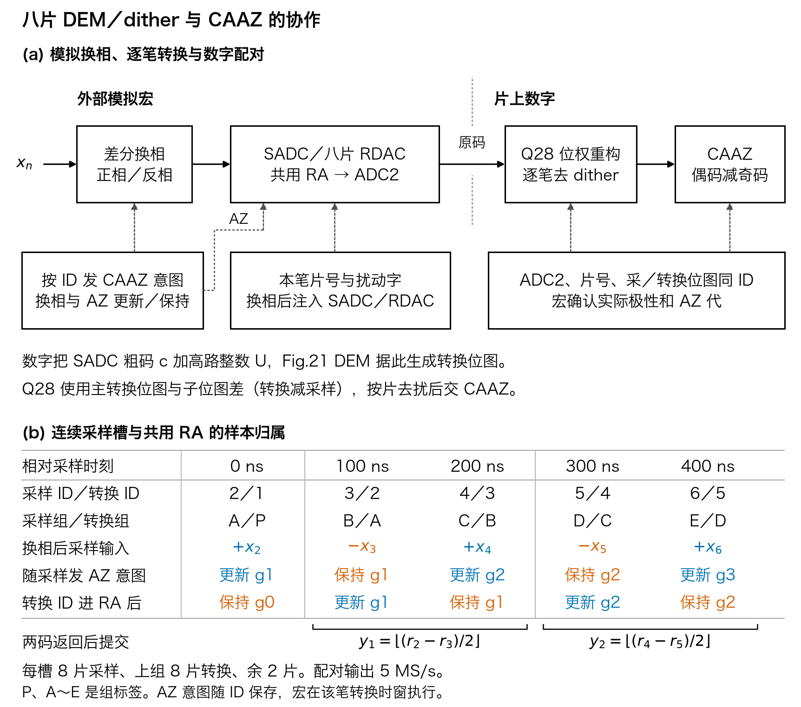
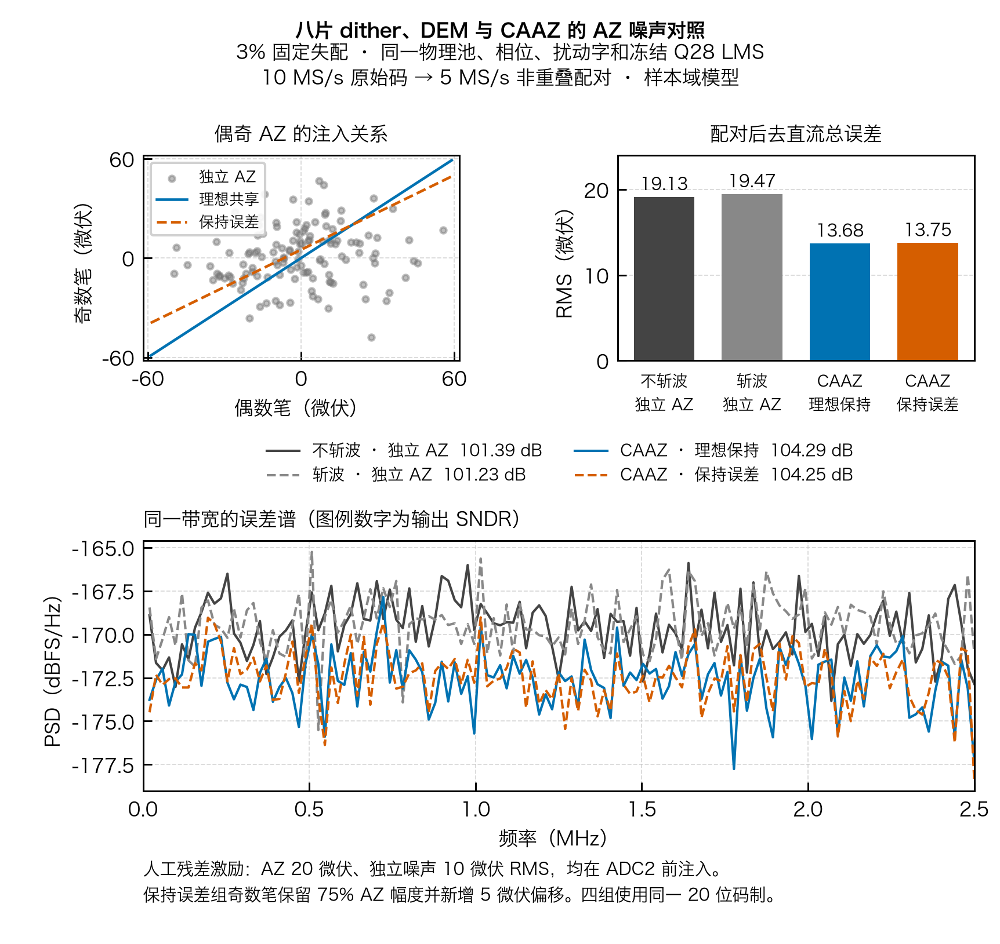
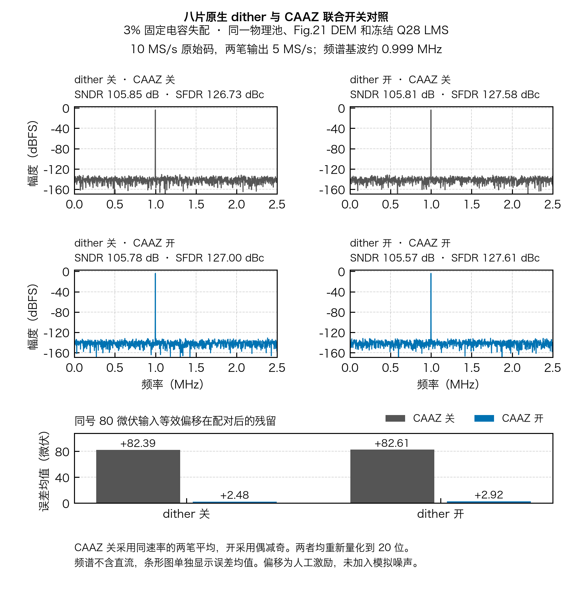

# 模块三 · CAAZ

CAAZ 对完整差分输入逐笔换相，偶数笔请求更新 CBIAS，奇数笔保持同一 AZ 代。ADC2、位权与同笔 dither 补偿完成后，数字端将偶数码减去奇数码并除以二。稳定工作时每两个 10 MS/s 原始结果提交一对，输出 5 MS/s。关闭 CAAZ 时逐笔旁路。


上图下半部分比较同为 5 MS/s、0～2.5 MHz 带宽的三组样本域结果。模型设置每笔独立噪声为 10 µV RMS，AZ 存储噪声为 20 µV RMS，输出均重新量化到 20 位。

| 处理方式 | 去直流误差（µV RMS） | 平均误差（µV） |
| :--- | ---: | ---: |
| 每笔自零，再两笔平均 | 16.16 | +42.41 |
| 偶数自零、奇数理想保持并反相 | 7.76 | +2.39 |
| 奇数保留 75% AZ 噪声，新增 5 µV 偏移 | 8.15 | −0.13 |

在此模型中，共用 AZ 样本比独立 AZ 后两笔平均的误差小 6.37 dB。若两相 AZ 传递增益分别为 `a_e`、`a_o`，奇数保持比例为 `h`，共同噪声项 `w` 的残余为 `(a_e−a_o·h)w/2`。这里的设置用于复核抵消机制，实际增益和保持误差由模拟验证给出。[数据、指标与图件哈希](evidence/behavior/caaz_effect_summary.json) · [原始轨迹](evidence/behavior/caaz_effect_data.npz) · [矢量图](evidence/behavior/caaz_effect.pdf)

## 与八片 dither 联合



每笔使用自己的切片编号、DEM 位图和 dither 字，先完成残差合并、位权重构和去扰，再按偶奇 ID 配对。共享的是 RA 的 AZ 代，不是两笔的切片或电容误差；AZ 请求必须随 ID 延迟至该笔实际进入 RA 的窗口。[协作图与接口](evidence/cooperation/README.md)

若偶、奇笔的信号为 `x偶、x奇`，共享 AZ 噪声为 `w`，奇笔的保持比例为 `h`，则输出的信号项为 `(x偶+x奇)/2`；共享噪声项为 `(a偶−h·a奇)w/2`。因此两笔对同一 AZ 状态的传递越一致，噪声抵消越充分；两笔不同的电容残余、量化误差和未消尽扰动不会自动消失。两点配对还会改变信号频响，并将输出速率从 10 MS/s 降到 5 MS/s。



在同一颗 3% 固定失配样本及相同 DEM、dither、冻结 LMS 下，示例将 AZ 噪声加在 CDAC 残差之后、ADC2 量化之前。等 5 MS/s 带宽下，独立 AZ 的配对误差为 19.13 µV RMS，理想共享为 13.68 µV RMS，加入示例保持误差为 13.75 µV RMS；上述噪声和保持参数均是人工设定。[模型、数据及验证范围](evidence/joint_noise/README.md)

故意把奇数笔的 dither 采样位图误绑定到上一偶数笔，会使同一 3% 模型的配对交流误差从 11.81 µV RMS 增至约 30.00 mV RMS，即使 ADC2 和重构未报越界。该试验是**人为注入的负对照**，当前 RTL 正常路径按 ID 绑定。[独立复验](evidence/independent_review/README.md)



该实验使用同一 3% 固定失配池、Fig.21 DEM、冻结 Q28 LMS 和相同 5 MS/s 输出带宽。dither 开启时，CAAZ 使平均误差从 +82.61 降到 +2.92 µV，SNDR 从 105.81 降到 105.57 dB。这里的 80 µV 偏移是**人为施加的输入等效差分偏移**，用于验证数字抵消，不代表真实模拟宏的噪声或失调测量。[四组条件、数据和复现](evidence/integrated/README.md)

| 源文位置 | 对应合同 | 当前边界 |
| :--- | :--- | :--- |
| Wang 等，VLSI 2025 Fig.5 | 在 ADC 输入换相，先做数据合并及位权校正，再作 `(1−z⁻¹)/2` | 本工程把运算限定在连续偶奇 pair，配对中点对应时间戳。两点平均幅频响应为 `abs(cos(πf/10 MHz))`，系统须另行定义抽二前带宽。 |
| 同论文 Fig.6，讲稿 PDF 第 34～35 页（幻灯片 33～34） | 偶数笔采集 AZ 噪声，奇数笔不更新 CBIAS，沿用同一代；同相误差在偶减奇中抵消 | `acq_az_capture`／`hold` 给出带 ID 的请求。宏需将该请求对齐到同 ID 的 RA 转换时窗，执行实际开关、隔离和保持，并随结果确认。其普通复位和放大准备由模拟时序负责。 |
| 论文原型测量 | 论文将 4.3 dB 区分为 AZ 抵消的 1.3 dB 和普通平均的 3 dB | 本工程模型幅度和频率独立设定。10／5 MS/s 为项目规格。 |

[论文 Fig.5／6](../references/PKU_VLSI2025_C32_1_PAPER.pdf#page=2) · [讲稿](../references/PKU_VLSI2025_C32_1_SLIDES.pdf#page=35) · [DOI](https://doi.org/10.23919/VLSITechnologyandCir65189.2025.11075015)

`caaz20_pair` 已以独立队列模型和 Verilator 逐拍核对 2,896 个时钟沿、1,625 个采样控制、675 个配对、256 个旁路输出及 10 次故障。覆盖错相、坏码、未发布／丢失／重复 ID、AZ 代和确认、运行中切换模式、暂停、清空、符号边界与 4 个 ID 进位边界。偶奇可用不同的 dither 字，每一笔按自身字先去扰，结果再参与 CAAZ。错误停止输出，须同步清空上下游后启动新 epoch。[接口合同](SPEC.md) · [RTL](rtl/caaz20_pair.sv) · [逐拍收据](evidence/rtl/result.json)

```sh
python -m pip install -r task1/requirements-calibration.txt
PYTHONPATH=.:src python task3/tools/run_caaz_checks.py --out /tmp/task3-rtl-run-001
PYTHONPATH=.:src python task3/tools/run_caaz_effect.py --out /tmp/task3-effect-run-001
yosys -s task3/tb/formal.ys  # Ubuntu 24.04 Yosys 0.33
```

整顶层的 RTL、GDS 和时序记录以[物理交付目录](../task2/physical/README.md)为准。真实 chopper、CBIAS、模拟宏跨域及联合后仿仍需要模拟组数据和约束。
