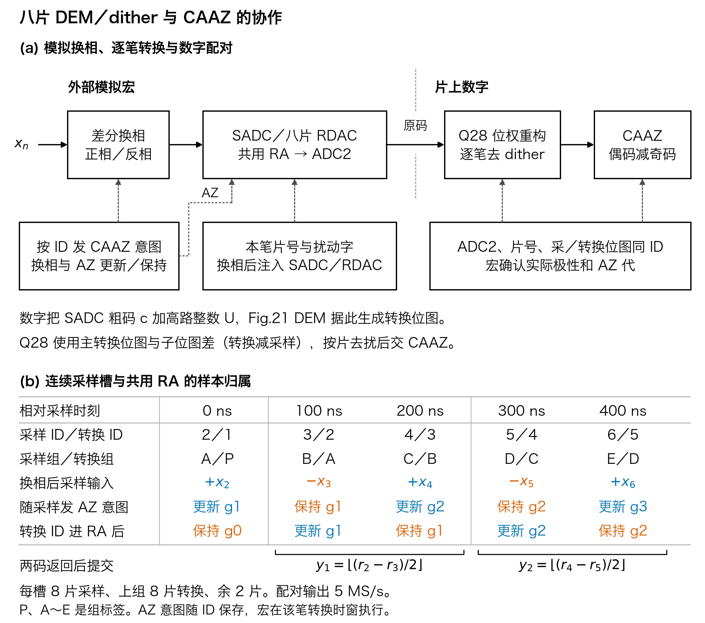

# 八片 DEM、dither 与 CAAZ 怎样协作



1. 每次成功申请从 18 片池中选出 8 片采样，并把上一笔的采样组交给转换。稳态同时有 8 片采样、8 片转换、2 片空闲。片号、DEM 相位和六位 dither 字按样本 ID 保存。调度、DEM 和 dither 各有独立的随机状态及种子，独立状态是工程设计选择。CAAZ 由 ID 奇偶确定，无需随机字。[调度规格](../../../task1/SPEC.md) · [八片扰动规格](../../../task2/eight_rtl/SPEC.md)
2. 采样时对整路差分输入换相，偶笔直通、奇笔交换。dither 在换相后的坐标注入，低路进 SADC 与 RDAC，高路进 RDAC。SADC 返回粗码 `c` 后，按本笔高路整数 `U` 得到 `k=c−U`（C9 负注入，`c<U` 下溢拒绝），Fig.21 映射再生成该笔的主、子转换位图。相邻组在同一槽中分属采样与转换，物理片号不重叠。3% 联合回放的 2,048 对中，片号重叠的有 0 对，dither 字不同的有 2,014 对。[跨段 DEM](../../../task1/BRIDGE_SPEC.md) · [注入与码域](../../../task2/eight_rtl/SPEC.md) · [3% 回放数据](../integrated/joint_dither_caaz_data.npz)
3. 采样描述符中的 `acq_az_capture`／`hold` 是带 ID 的**提前意图**。模拟时序在该笔进入共用 RA 的对应时窗执行更新或保持。比如图中 ID 3 采样时发布“保持 g1”，同槽 RA 正在转换 ID 2 并更新 g1。下一槽 ID 3 进入 RA 时才执行保持。宏随 ADC2 返回 ID、实际极性、AZ 代和确认，数字顶层校验后再配对。[CAAZ 接口](../../SPEC.md) · [片上顶层](../../../task_integration/rtl/sar20_digital_lms_top.sv)
4. 冻结的 LMS 系数按该笔的物理片号和位图合并 ADC2 原码。主阵列使用转换位图，子阵列使用 `转换位图 + 采样位图`（C9 负注入：采样存 `x−T`，故重构要把 T 加回来一次），在斩波后的码域同时完成位权重构与 dither 去除，得到 `r[n]`。随后 CAAZ 验证相邻偶奇 ID、实际极性与相同 AZ 代，再提交 `floor((r_even − r_odd)/2)`。保持上一代 CBIAS 可以让两笔共用其误差，电容失配、随机选片与 dither 则按每笔自己的开关记录处理。[Q28 参考](../../../task_reconstruction/fixed.py) · [配对 RTL](../../rtl/caaz20_pair.sv)

> ⚠️ 本目录的 `joint_dither_caaz_data.npz` 与 2,048 对回放数字生成于 C9 之前（`k=c+U`、`转换位图−采样位图`），**留档但不得作为 C9 验收证据**，须按负注入整体重生成。

## 共用 AZ 代抵消什么

用输入折算电压表示完成逐笔重构后的偶、奇笔。`x_e` 和 `x_o` 是相差 100 ns 的真实输入，`w_g` 是本对的共同 AZ 采样误差，`a_e`、`a_o` 是两相的 AZ 传递系数，`h` 为奇笔保持比例。`b_e`、`b_o` 表示两相的剩余偏移，`η_e`、`η_o` 包含两笔各自剩余的失配、量化及独立噪声。

```text
r_e = +x_e + b_e + a_e · w_g     + η_e
r_o = −x_o + b_o + a_o · h · w_g + η_o

(r_e − r_o) / 2
    = (x_e + x_o) / 2
    + (b_e − b_o) / 2
    + (a_e − a_o · h) · w_g / 2
    + (η_e − η_o) / 2
```

理想保持 `h=1` 且两相传递系数相同，共同 AZ 误差抵消。保持漏失、两相传递不等或独立误差都留下残余。两点平均在 10 MS/s 原始采样下的幅度响应为 `|cos(πf / 10 MHz)|`，输出为 5 MS/s。模拟换相建立、CBIAS 保持与泄漏、真实噪声传递以及抽二前抗混叠由模拟与系统验证闭合。图按样本槽解释归属，配对结果的实际返回时刻取决于宏交接和数字流水。[重构流水及握手](../../../task_integration/LMS_PIPELINE.md) · [同带宽噪声对照](../behavior/caaz_effect_summary.json) · [3% 失配联合开关对照](../integrated/README.md)

ISSCC 2024 的 Fig. 9.8.1、Fig. 9.8.3 对应 18 片交织、共用 RA 与 DEM／dither 架构。北大 VLSI 2025 的 Fig. 5、Fig. 6 对应输入反相和偶笔更新、奇笔共用 AZ。这里将两篇的机制组合到 10 MS/s 原始码、5 MS/s 配对码的工程合同中。[ISSCC 论文](../../../references/ISSCC2024_PAPER.pdf#page=2) · [ISSCC 讲稿](../../../references/ISSCC2024_SLIDES.pdf#page=17) · [北大论文](../../../references/PKU_VLSI2025_C32_1_PAPER.pdf#page=2) · [北大讲稿](../../../references/PKU_VLSI2025_C32_1_SLIDES.pdf#page=34)

## 复现

```sh
PYTHONPATH=.:src MPLBACKEND=Agg python task3/tools/draw_cooperation.py --out /tmp/task3-caaz-cooperation-001
```

PDF 和 SVG 将字体转为矢量字形，绘图源码保留可编辑标签。已复核 146 mm 版面的彩色和灰度渲染。[可编辑绘图源码](../../tools/draw_cooperation.py) · [PDF](caaz_cooperation.pdf) · [SVG](caaz_cooperation.svg) · [图件、源码和原文 SHA-256](summary.json)
