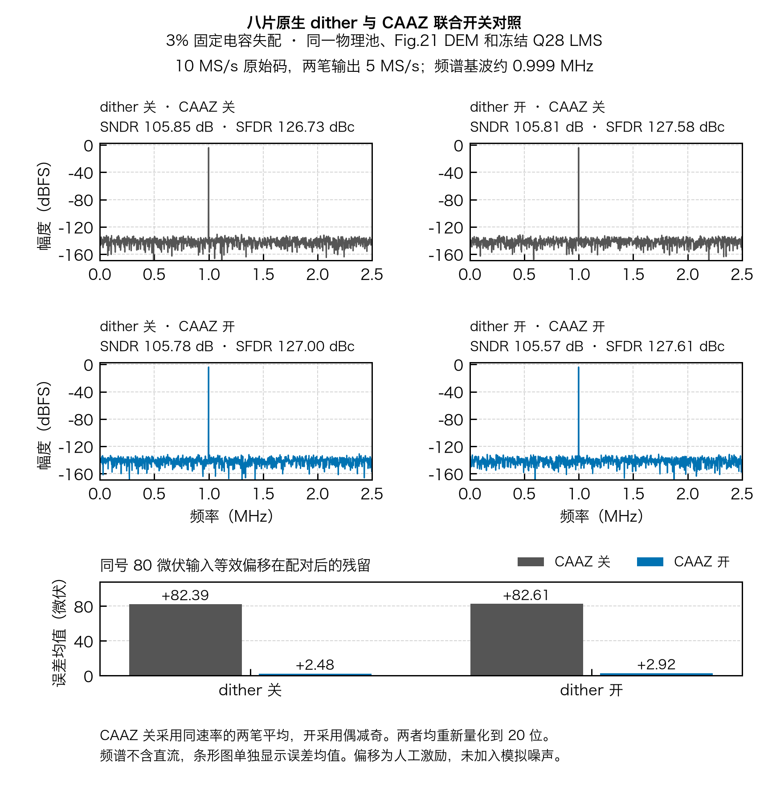

# 八片 dither 与 CAAZ 联合开关对照



四组均使用同一个 3% 固定失配电容池（制造种子 100）、18 片池中每笔采样 8 片的原有切片序列、Fig.21 DEM 相位及同一套冻结 Q28 LMS 系数。dither 打开时沿用归档的六位字序列，通过原生子阵列底板的电荷模型注入，关闭时字为零。每组 4,096 笔，输入频率 998.535 kHz、峰值 3.333 V，理想 ADC2 输入等效窗口 ±100 mV。四组前级、ADC2 及 20 位重构均无拒样；ADC2 残差合计范围 −40.93 至 +43.58 mV。

沿用 RTL 对拍的确定性激励，在斩波后输入上加入同号的 +80 µV 差分偏移。CAAZ 开启组对同一信号先正相、后反相，再按 `floor((even−odd)/2)` 输出。关闭组用两笔正相码中心的平均后重新量化，作为等速率分析基线。两组均得到 2,048 个 20 位结果，以 5 MS/s、同一个 0～2.5 MHz 频带和相干矩形窗计算频谱。误差均值参考两笔理想输入的平均；频谱指标排除直流。

| dither | CAAZ | 偏移残留（µV） | 去直流误差（µV RMS） | SNDR（dB） | SFDR（dBc） |
| :---: | :---: | ---: | ---: | ---: | ---: |
| 关 | 关 | +82.39 | 11.43 | 105.85 | 126.73 |
| 关 | 开 | +2.48 | 11.55 | 105.78 | 127.00 |
| 开 | 关 | +82.61 | 11.49 | 105.81 | 127.58 |
| 开 | 开 | +2.92 | 11.81 | 105.57 | 127.61 |

dither 打开时，CAAZ 将平均误差降低约 79.69 µV，SNDR 同时下降 0.24 dB，SFDR 改变约 +0.03 dB。此组验证同号偏移的配对抵消。输入偏移为人工激励，四组均未注入模拟热噪声、1/f 噪声或 CBIAS 保持误差。实际 AZ 噪声和宏时序需要模拟验证。

开启 dither 和 CAAZ 的原始事务向量 SHA-256 与已归档的 Verilator 3% 逐笔夹具完全一致。其余三组由同一电荷和整数重构参考重放，用作匹配的行为对照。[逐笔 RTL 收据](../../../task_integration/evidence/on_chip/result.json) · [3% 电容及训练数据](../../../task2/evidence/eight_native/sigma_3pct/data.npz) · [四组逐笔结果](joint_dither_caaz_data.npz) · [指标和 SHA-256](summary.json) · [PDF 图](joint_dither_caaz.pdf)

```sh
PYTHONPATH=.:src python task3/tools/run_joint_effect.py --out /tmp/task3-joint-effect-001
```
