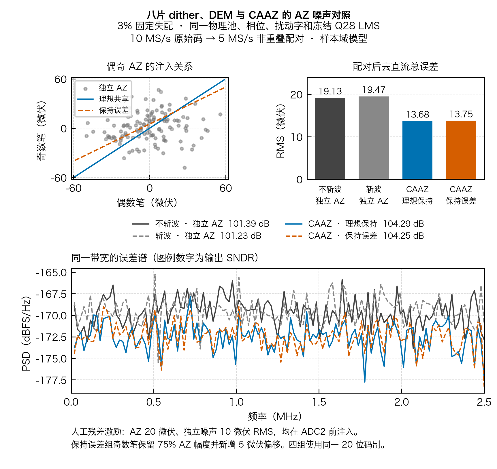

# 八片 dither、DEM 与 CAAZ 的等带宽 AZ 噪声对照



四组沿用同一颗 3% 固定失配虚拟芯片（种子 100）、同一 18 片池及每笔采样的 8 片、同一 Fig.21 DEM 相位、同一六位扰动序列和同一套冻结 Q28 LMS 系数。输入是 998.535 kHz、峰值 3.333 V 的相干正弦。各组取 4,096 笔 10 MS/s 原始码，计算 2,048 对 5 MS/s 的 20 位结果。频谱指标使用完整记录的相干 FFT，去除直流；图中 PSD 使用配对输出误差的八段 256 点矩形窗平均，分析带宽统一为 0～2.5 MHz。

| 方式 | AZ 偶奇样本 | 输出去直流误差（µV RMS） | 输出均值误差（µV） | SNDR（dB） | SFDR（dBc） |
| :--- | :--- | ---: | ---: | ---: | ---: |
| CAAZ 关，两笔正相平均 | 每笔独立 | 19.13 | +82.14 | 101.39 | 122.48 |
| 反相消融，偶减奇 | 每笔独立 | 19.47 | +1.83 | 101.23 | 122.97 |
| CAAZ 开，偶减奇 | 共享、理想保持 | 13.68 | +1.79 | 104.29 | 126.58 |
| CAAZ 开，偶减奇 | 共享、奇数保持受损 | 13.75 | −0.46 | 104.25 | 125.97 |

在这组激励下，相比等速率的独立 AZ 平均，理想共享使去直流误差从 19.13 降到 13.68 µV RMS，SNDR 提高 2.90 dB。只反相仍逐笔更新 AZ，虽消除了大部分同号偏移，去直流误差仍为 19.47 µV RMS。保持受损使 SNDR 较理想共享低 0.04 dB、SFDR 低 0.60 dB。

## AZ 噪声进入哪里

按北大 VLSI 2025 Fig.5／6，奇数笔输入反相，RA 的 AZ 存储误差仍与偶数笔同向。在本模型中，先依据干净的 `±x`、SADC 低路扰动和八片物理 mask 算出 CDAC 残差，再在 **ADC2 量化前**加入 RA 噪声和偏移。扰动单位为 ADC2 名义输入折算电压。理想 RA 增益的折算、白噪声幅度和保持系数是人工模型条件。[论文 Fig.5／6](../../../references/PKU_VLSI2025_C32_1_PAPER.pdf#page=2)

AZ 样本由 PCG64 `0x0A2E2025` 生成，标准差 20 µV。独立噪声由另一流 `0x0FCE2025` 生成，标准差 10 µV；四组逐笔复用这组独立噪声。两笔均有同号 +80 µV RA 等效偏移。理想共享组用 `w`、`w`，保持受损组用 `w`、`0.75w+5µV`。此前[偏移联合图](../integrated/README.md)的 80 µV 加在斩波后前级输入，和这里的 RA 残差注入点不同。

将偶奇两笔的有效噪声传递系数记为 `a_e`、`a_o`，保持比例为 `h`，保持新增偏移为 `δ`。偶减奇后，同一 AZ 样本留下 `(a_e−h·a_o)w/2−a_o·δ/2`。按归档 LMS 的逐笔增益 `a_i=1/Ĝ_i` 在线性化后估计，这一项的去直流 RMS 在理想共享组约 0.027 µV，保持误差组约 2.505 µV。表中总误差还包含两笔独立噪声、12 位 ADC2 的量化阈值变化、20 位舍入及未完全补偿的 dither／电容失配。计算总误差时参考信号为两笔实际输入的平均 `(x_e+x_o)/2`，保留配对孔径的带宽和相位影响。

## 和 DEM、dither 怎样配合

2048 对均使用两组互斥的物理切片，2014 对的 dither 字不同。每一笔先按自己的片号、转换与采样位图、ADC2 码和冻结 Q28 权重重构，去掉同笔 dither 后，再交给 CAAZ 配对。共享的是 RA 的 AZ 代和相应模拟存储状态。两笔各自的失配、增益和剩余扰动都保留，配对时只会按实际误差相减。

控制端按采样 ID 提前发布换相及 AZ 更新／保持意图。模拟接口需随该 ID 将 AZ 意图交给对应 RA 窗口，再通过同笔确认归属；采样描述符的发布脉冲仅表示登记。四组 SADC、RDAC 命令和采样档位、ADC2、Q28 和最终 20 位输出均无越界或拒样，带噪 ADC2 输入合计范围 −40.93～+42.30 mV，模型窗口为 ±100 mV。

图表验证的是上述固定失配池中的同笔处理和共享噪声机制。实际 CBIAS 保持、RA 增益及噪声谱、斩波建立与跨域时序仍由模拟宏和联合后仿验证。论文的 4.3 dB 含普通两笔平均和 AZ 项抵消；本对照的各组已经采用相同的两笔处理速率。

[完整采样与重构轨迹](caaz_joint_noise_data.npz) · [指标、参数与 SHA-256](summary.json) · [PDF 图](caaz_joint_noise.pdf) · [3% 物理池与训练数据](../../../task2/evidence/eight_native/sigma_3pct/data.npz)

摘要记录归档对拍的配置字和逐笔向量标识，带噪四组各自保留新向量的哈希。PDF 导出矢量字形，绘图脚本和 SVG 随图保存。

```sh
PYTHONPATH=.:src python task3/tools/run_joint_noise.py --out /tmp/task3-joint-noise-001
```
